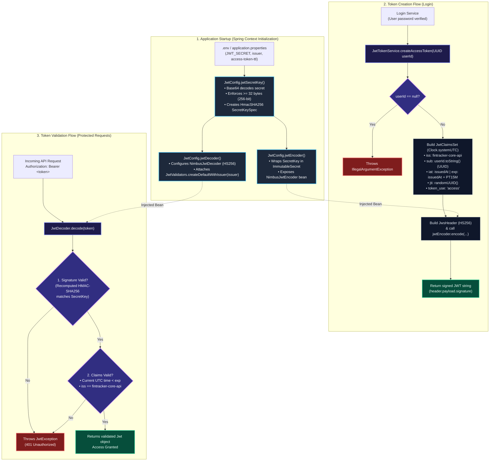

# FinTracker Core API — JWT Architecture & Lifecycle

This document outlines how `JwtConfig` and `JwtTokenService` collaborate to issue and validate short-lived access tokens (`HS256`).

---

## 1. Visual Flowchart (Renders Automatically on GitHub & VS Code with Mermaid)



---

## 2. Universal ASCII Flowchart (Works in Every Editor & Terminal)

```text
================================================================================
 1. APPLICATION STARTUP (JwtConfig.java)
================================================================================
  [.env: JWT_SECRET] ──► Base64 Decode & Verify >= 32 bytes
                                │
                                ▼
                        [SecretKey Bean] (HmacSHA256)
                         ├──► Injects into ──► [JwtEncoder Bean] (NimbusJwtEncoder)
                         └──► Injects into ──► [JwtDecoder Bean] (NimbusJwtDecoder + Issuer Validator)

================================================================================
 2. TOKEN CREATION FLOW (JwtTokenService.java)
================================================================================
  [Login Verified]
         │
         ▼
  createAccessToken(UUID userId)
         ├──► If userId == null ──► Throw IllegalArgumentException
         │
         ▼
  Build JwtClaimsSet (Clock.systemUTC)
   • iss: "fintracker-core-api"
   • sub: userId.toString()
   • iat: now | exp: now + 15 mins (PT15M)
   • jti: randomUUID()
   • token_use: "access"
         │
         ▼
  [JwtEncoder] signs Header (HS256) + Claims using SecretKey
         │
         ▼
  Returns Signed JWT ("header.payload.signature")

================================================================================
 3. TOKEN VALIDATION FLOW (Protected Endpoints)
================================================================================
  [Incoming Request: Authorization: Bearer <token>]
         │
         ▼
  [JwtDecoder.decode(token)]
         ├──► 1. Signature Check (Recomputes HMAC-SHA256 with SecretKey)
         ├──► 2. Expiration Check (Current UTC time < exp)
         └──► 3. Issuer Check (iss == "fintracker-core-api")
                   │
                   ├──► Any Check Fails ──► Throw JwtException (401 Unauthorized)
                   └──► All Checks Pass ──► Return validated Jwt (Access Granted)
```

---

## 3. Component Summary

| Class | Role | Key Responsibilities |
| :--- | :--- | :--- |
| **`JwtConfig`** | Cryptographic Factory | • Reads Base64 `JWT_SECRET` from environment variables.<br>• Enforces a 256-bit (32-byte) minimum key length at startup.<br>• Registers singleton `SecretKey`, `JwtEncoder`, and `JwtDecoder` beans.<br>• Configures `JwtValidators.createDefaultWithIssuer(issuer)` to reject tokens from external issuers. |
| **`JwtTokenService`** | Token Builder | • Generates short-lived (`PT15M`) access tokens using `Clock.systemUTC()`.<br>• Sets immutable user `UUID` as `sub` instead of mutable email addresses.<br>• Adds unique `jti` IDs and `token_use: "access"` claims. |